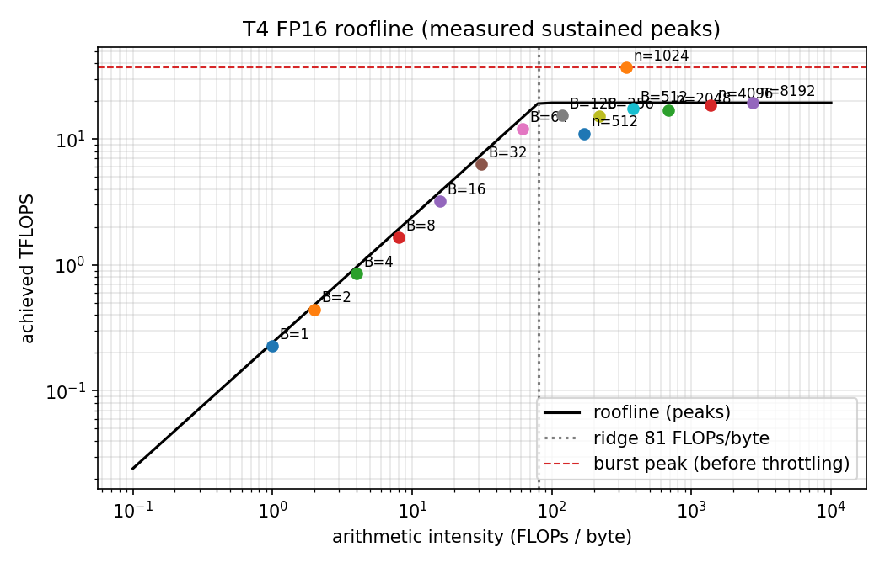

# 02. GPU basics: bandwidth, matmul, roofline (Lesson A2)

## Three ideas

1. **Decode is limited by memory bandwidth.** Producing one token reads every weight once.
2. **Prefill is limited by compute.** Many tokens share one read of the weights.
3. **Roofline.** A kernel does `FLOPs` of work and moves `bytes`. Its *arithmetic intensity* is `FLOPs / bytes`. The *ridge point* is `peak FLOPs / peak bandwidth`. Below it the kernel is memory-bound (speed = intensity x bandwidth); above it, compute-bound (speed = peak FLOPs).

For a decode matmul `(B, K) @ (K, N)` the weight (`K*N` elements) dominates the bytes, so intensity is about `B`. **Batching raises intensity at almost no extra memory cost.**

## What we measured on the T4 (FP16, ranges over 7 trials)

| Quantity | Datasheet | Measured | Note |
|---|---|---|---|
| Memory bandwidth (256 MiB copy) | 320 GB/s | **241 GB/s** (240.5 to 241.2 at 64 MiB) | 75% of datasheet. 1 MiB buffers are launch-overhead dominated, so we use 64 MiB and up |
| FP16 matmul, sustained (n=8192) | 65 TFLOPS | **19.4 TFLOPS** (19.0 to 19.8) | 30% of datasheet |
| FP16 matmul, burst (n=1024) | 65 TFLOPS | 37.3 TFLOPS | short run before the clock drops; n=2048 swung between 13.6 and 41.2 |
| FP32 matmul | 8.1 TFLOPS | 3.0 TFLOPS | 37% of datasheet |

Footnote: `nvidia-smi` showed a 70 W power limit and an SM clock of 585 MHz against a 1590 MHz maximum at 72 C. That is why the T4 varies run to run and why we report ranges, and why we use the *sustained* number as the compute roof.

**Ridge point:** 65 TFLOPS / 320 GB/s = 203 FLOPs/byte on the datasheet, but 19.4 TFLOPS / 241 GB/s = **81 FLOPs/byte** on measured sustained numbers. We use the measured one.

## Batching, measured

One TinyLlama MLP up-projection, `(B, 2048) @ (2048, 5632)` in FP16 (23 MB of weights, larger than L2):

| B | ms | intensity | GB/s | TFLOPS | rows/s |
|---|---|---|---|---|---|
| 1 | 0.102 | 1.0 | 227 | 0.23 | 9,827 |
| 8 | 0.111 | 8.0 | 209 | 1.66 | 71,983 |
| 64 | 0.123 | 61.4 | 196 | 12.0 | 522,057 |
| 128 | 0.191 | 117.9 | 131 | 15.5 | 669,736 |
| 512 | 0.681 | 381.8 | 45 | 17.4 | 752,217 |

From B=1 to B=64 the time grows by about 20% while the work grows 64x, so rows per second grow about 53x. Past B=64 the intensity crosses the ridge (81), time starts growing with `B`, and throughput flattens near the compute roof.

## Decode ceiling for TinyLlama

`weight bytes / bandwidth` = 2.2 GB / 241 GB/s = about 9.1 ms per step, so at most **about 110 tokens/s at batch 1**. Real decode is slower (KV-cache reads, small-kernel overheads, sampling, Python). In Part E we will compare actual speed to this ceiling.

Caveat: batching amortizes the *weight* reads. Attention over the KV cache reads each sequence's own cache, so that part does not get cheaper per token with batching. Long contexts and large batches therefore eventually become KV-bandwidth-bound too.

## Code map

- [roofline.py](../../tinyserve/roofline.py): pure-Python math (FLOPs, bytes, intensity, ridge, attainable FLOPs, decode ceiling, `summarize` for ranges).
- [gpu.py](../../tinyserve/gpu.py): CUDA-event timing, bandwidth / matmul / decode-curve measurements.
- [plots.py](../../tinyserve/plots.py): the roofline diagram as code.
- [test_a2_roofline.py](../../tests/test_a2_roofline.py): exact math tests plus GPU sanity checks (9 pass on the T4).
- [A2 notebook](../../notebooks/A2_gpu_bandwidth_roofline.ipynb) and [results](../../results/A2_gpu.json).

## Interview questions

1. **Why is single-sequence decode memory-bound, and what does batching change?**
   Each step does about 2 FLOPs per weight but must read each 2-byte weight from memory, so intensity is about 1 FLOP/byte, far below the T4's ridge (about 81). Speed is set by bandwidth. Batching `B` sequences reuses one weight read for `B` tokens, so intensity rises to about `B` and throughput scales almost linearly until the ridge point (we measured about 53x for B=64).

2. **What is the roofline model, and how do you compute the ridge point?**
   Attainable speed = `min(peak FLOPs, intensity x peak bandwidth)`. The ridge point is peak FLOPs divided by peak bandwidth, the intensity where the two limits meet. Left of it a kernel is memory-bound, right of it compute-bound. On our T4: 19.4 TFLOPS / 241 GB/s = 81 FLOPs/byte.

3. **How would you estimate the best-case decode speed of a model, and why would real numbers be lower?**
   `bandwidth / bytes of weights read per step`: 241 GB/s / 2.2 GB = about 110 tokens/s for TinyLlama FP16 at batch 1. Real decode is lower because of KV-cache reads (which do not amortize with batching), launch overheads, sampling and Python. Also, measured numbers (241 GB/s, 19.4 TFLOPS) are well below datasheet peaks, so use measured ones and report ranges.
